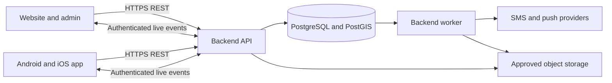
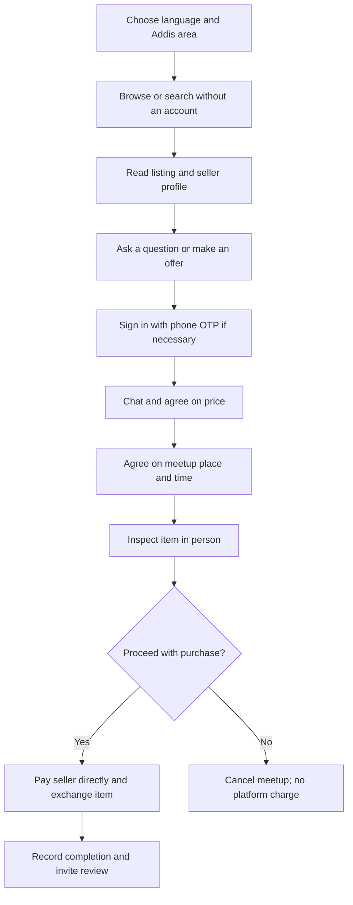

# OFFERME: Addis Ababa marketplace implementation plan

Research date: October 27, 2026.
Scope confirmed: October 27, 2026.

## 1. Confirmed product decisions

**OFFERME** is an original secondhand marketplace for **Addis Ababa**, using OfferUp's current local buying and selling flow as its reference.

| Decision | Confirmed scope |
| --- | --- |
| Product name | OFFERME |
| Launch market | Addis Ababa |
| Launch catalog | All general secondhand categories; category-specific posting and moderation rules apply |
| Clients | Responsive website, Android app, and iOS app |
| Interface languages | Amharic, Afaan Oromo, and English |
| Exchange | Buyer and seller agree in chat, meet locally, inspect the item, and exchange it in person |
| Payment | Buyer pays the seller directly after inspection; participants agree on the payment method |
| Fulfillment | Local pickup and meetups; no riders, courier service, or platform delivery |
| Development | One founder working with AI assistance |
| Source structure | Independent `backend`, `website`, and `app` directories; no shared source directory or shared package |

OFFERME records listings, conversations, agreed prices, meetup arrangements, and participant-reported sale outcomes. It does not collect purchase money, hold escrow, maintain a customer wallet, or pay sellers. This follows OfferUp's current buyer-to-seller payment model. [OfferUp buying guidance](https://help.offerup.com/hc/en-us/articles/360032334971-Best-practices-for-buying)

The launch scope is settled: OFFERME is an Addis Ababa marketplace for local exchanges. Rider and delivery operations are excluded from the architecture, roadmap, budget, and launch requirements.

Project directory: `C:\Users\eyoba\Documents\WEB PROJECTS\Offerup`. Keep this directory name; the customer-facing product name is OFFERME. Implementation is in progress. The current state and next steps are recorded below.

### Workspace and implementation status - November 4, 2026

All OFFERME development belongs in `C:\Users\eyoba\Documents\WEB PROJECTS\Offerup`. Source files, dependencies, build output, tests and local development data stay here. The former OFFERME staging directory and plan in portmaker are absent. Keep independent `backend`, `website`, and `app` projects; the clients have their own API types and translation dictionaries, with no shared source imports.

| Area | Verified current state |
| --- | --- |
| Backend | NestJS runtime, phone OTP authentication, PostgreSQL migrations, listing/photo operations, favorites, conversations, offers, meetup coordination, reports, blocking, administrator moderation endpoints, documentation and authenticated socket notifications are implemented. Block checks now also protect meetup status changes. Client IPs for authentication rate limits are derived from the socket/configured trusted proxies, replacing any supplied internal IP header. |
| Website | Responsive Next.js screens/routes implement browsing, category/neighborhood/condition/price filters, sorting/pagination, phone sign-in, listing details, photo posting/editing, favorites, profile updates, listing lifecycle management, messages, structured offers, meetups, reporting/blocking and an administrator report queue. Loading, error, empty and sign-in-required states are present. |
| Native app | Independent Expo Router / React Native screens implement Explore, Saved, Sell, Messages and Account tabs, listing details/editing, OTP sign-in, system photo selection/upload, conversations, offers, meetup proposals/responses, listing reports and user blocking. Sessions use Better Auth's Expo adapter and SecureStore. |
| Languages | English, Amharic and Afaan Oromo selection and core marketplace strings are implemented in each client. Language preference persists locally. Some safety/admin copy, validation errors and secondary labels remain English; translations require fluent-speaker review before launch. |
| Backend verification | Typecheck, build and the real PostgreSQL API integration test pass. Tests cover authentication, listing/media ownership, public profile privacy, saved-item deduplication, conversation access, message retries, offer permissions, meetup transitions, blocked-user messaging/meetup updates and sold-state restrictions. Administrator report resolution, listing removal, audit events, non-admin denial and removed-listing reopening restrictions are also verified. |
| Website verification | Production build and TypeScript compilation pass. A real Chromium browser journey passes with separate seller/buyer sessions: OTP sign-in, profile naming, image upload, listing publication, search, favorite/save retrieval, chat, offer acceptance, meetup confirmation, sold-state behavior and sign-out. Language switching/persistence and a 390px viewport overflow check pass. Desktop/mobile screenshots were visually inspected. |
| Native verification | Expo SDK compatibility check and TypeScript check pass. Android and iOS Hermes bundles/assets export successfully. Android browsing and phone sign-in reached the account screen during emulator testing. That test exposed bare text spaces inside native layout components; those have been removed from Account, chat, listing details and Sell. A new `npm.cmd run check:jsx` check detects this regression. Full native journeys, session persistence and iOS runtime still require verification. The November 4 runtime retry was inconclusive because the Android emulator repeatedly failed to provide a usable UI, including System UI failures; a fresh boot with lower memory did not resolve it. The temporary emulator was stopped. |
| Local runtime | PostgreSQL runs locally at 127.0.0.1:55433. The website preview is http://127.0.0.1:3100 and API is http://127.0.0.1:4100, both bound locally. Startup and development OTP logs are in backend/.local/api-output.log; website logs are in website/.local/web-output.log. README.md documents setup and device networking. |

The browser suite uses separate localhost ports 3101/4101 and a temporary test database. Test OTP capture and a token-protected cleanup listener on 4102 exist only in the dedicated test entry point, not the production API. Teardown was verified to remove the temporary database and clear captured codes. Test listings are not inserted into the normal marketplace. The normal development database starts empty.

The native project now uses Expo 58.0.21, React Native 0.88.1 and TypeScript 6.0.3, aligned with Expo's compatibility check. Local Android development can use `npm.cmd run android:local`, which forwards API and Metro ports over ADB when the standard emulator host address is unreachable. API/auth requests have a 15-second timeout. Its unused openapi-typescript dependency was removed because that generator currently requires TypeScript 5. Native and web API response types are handwritten locally; complete response schemas and generation remain a separate task.

#### Remaining work before release

- Complete production SMS delivery/provider verification, production object storage, deployment configuration, backups and monitoring.
- Test complete native journeys on Android and iOS, including camera/library permissions, session persistence/revocation, background/foreground behavior and unreliable networks. Expo exports are not signed APK/IPA releases.
- Add participant reviews/reputation, saved searches, push notifications, durable listing drafts, broader moderation workflows and PostGIS distance queries.
- Complete API response schemas/generated client contracts and finish localization, including safety copy and errors. Review translations with fluent Amharic and Afaan Oromo speakers.
- Verify socket/session lifecycle behavior and production reverse-proxy trust configuration. Auth schema warnings can appear before migrations on a new test database; migrated sign-in is tested.
- Resolve upstream dependency advisories before release. The October 30 native audit reported eight affected packages (three high, five low), traced to Expo CLI's Zod 3 and deepmerge dependencies. The proposed npm audit fix would downgrade Expo across major versions and was not applied. The currently published deepmerge version remains affected; a compatible upstream fix needs tracking.

This milestone delivers working local website flows, verified administrator API operations, and native rendering fixes with successful platform exports. It is not a production launch. The next milestone is native runtime verification, followed by reviews/reputation and production service integrations.

## 2. What OfferUp actually does today

### Evidence and limits

The reconstruction uses OfferUp's current support documentation and public website. The signed-in native app was not personally exercised, and no private API, source code, or internal architecture was inspected. The technology recommendations below are for your product, not claims about OfferUp's stack. A later product-design pass should validate authenticated screen details on an authorized account where the service is available.

An important correction to older tutorials: OfferUp stopped allowing shipping on new listings on September 23, 2025, and removed shipping from existing listings on October 21, 2025, with an exception for transactions already underway. Its current policy is local pickup. Historical shipping-payment and protection flows should not be treated as today's requirements. [OfferUp shipping announcement](https://help.offerup.com/hc/en-us/articles/41043186552980-Nationwide-shipping-ending)

### Feature reconstruction

| Capability | Verified OfferUp behavior | Direction for OFFERME |
| --- | --- | --- |
| Discovery | Search and category browsing; price, condition, and location controls; sorting by relevance, recency, distance, or price. | Start with nearby listings, clear filters, and predictable sorting. |
| Listing creation | Current app and website both support posting. The documented app form supports up to 12 photos and one video; the web form supports up to 12 photos. Required fields include title, price, category, condition, location, and a photo. | Build full posting on both clients. Recommend photos first; defer video. |
| Questions and offers | Both clients support listing questions and price offers through messaging. Sellers can accept, decline, or counter. General profile chat requests are documented as app-only. | Start with conversations tied to a listing and structured offer cards. |
| Transaction | Participants agree on price and payment, meet, inspect, and exchange payment/item directly. | Implement meetup coordination, not an online item checkout. |
| Reputation | Profiles show ratings, rating count, activity, transaction counts, and verification/reply badges. | Show clearly defined signals; distinguish identity checks from successful transactions. |
| Identity | TruYou uses identification and selfie checks through a third party; application is app-only. A badge is not a guarantee of trustworthiness. | Phone verification first; evaluate an optional local identity integration later. |
| Listing management | Sellers can edit and archive listings, restore archived listings, and mark an item sold. OfferUp documents marking sold as irreversible. | Define explicit lifecycle states; prevent accidental sale completion. |
| Monetization | Local transactions have no OfferUp commission. Paid products include promotion, extra listing allowances, subscriptions, and other verticals. | Prioritize marketplace activity before monetization. |

Sources: [Search](https://help.offerup.com/hc/en-us/articles/360032334711-Search-for-items-to-buy), [Posting on app and web](https://help.offerup.com/hc/en-us/articles/360031987592-Post-an-item-to-sell), [Messaging](https://help.offerup.com/hc/en-us/articles/360032336111-How-to-use-messaging), [Reputation](https://help.offerup.com/hc/en-us/articles/360032336491-About-your-reputation), [TruYou](https://help.offerup.com/hc/en-us/articles/360031993072-TruYou-verification-program), [Listing management](https://help.offerup.com/hc/en-us/articles/360032335951-Update-an-item-listing), [Free and paid features](https://help.offerup.com/hc/en-us/articles/360031989092-What-is-OfferUp).

### Core loops to reproduce

- Buyer: discover an item → examine its condition and seller → ask or offer → agree on a meetup → inspect → pay seller directly → review the interaction.
- Seller: photograph an item → publish → answer inquiries → negotiate → meet buyer → receive payment → mark sold → review the buyer.
- Retention: saved items/searches, useful notifications, fresh inventory, responsive sellers, and trustworthy interactions bring users back.

Flow references: [OfferUp buying steps](https://help.offerup.com/hc/en-us/articles/360031993392-How-to-buy-on-OfferUp), [OfferUp selling guidance](https://help.offerup.com/hc/en-us/articles/51328857940756-Best-practices-for-selling). Retention priorities are product-design recommendations.

The important product is the complete path from discovery to a completed exchange. A grid of product cards alone does not reproduce it. Your own interface, brand, wording, and implementation should express those functions.

The current posting guide also describes optional AI title/description suggestions in the app and a 30-minute Premium-only visibility period for new listings. These are documented product details, not recommended launch requirements for a marketplace that still needs inventory and participation. [Current posting guide](https://help.offerup.com/hc/en-us/articles/360031987592-Post-an-item-to-sell)

## 3. What must change for Ethiopia

### Market position

Jiji already operates in Ethiopia and documents listings, negotiation through calls/chat, and payment after receiving an item. We should validate a specific improvement over existing options: better used-item condition descriptions, a useful neighborhood feed, reliable chat, and clearer reputation. An empty-market assumption would be wrong. [Jiji Ethiopia's buyer and seller flows](https://jiji.com.et/about.html)

Ethio telecom reports 52.5 million data/internet users for its 2025/26 performance period. This supports testing a mobile-oriented product, but is an operator-reported metric, not a count of unique prospective marketplace customers. Its reported network coverage also does not establish the connection quality of our target users. [Ethio telecom annual report](https://www.ethiotelecom.et/2025-26-budget-year-annual-business-performance-report/)

With all general secondhand categories included at launch, interview a proposed 10-15 buyers and 10-15 sellers in Addis to validate the category tree, listing attributes, and common exchange problems. Observe how they discover items, judge defects, negotiate, verify a transfer, and arrange collection. This is proposed fieldwork, not completed research.

### Launch catalog and geographic scope

OFFERME launches with all general secondhand categories enabled. A small pilot cohort may test the product before release, but the launch catalog is not limited to a few categories.

Organize the catalog into configurable top-level groups: phones and tablets; computers and electronics; furniture and home goods; appliances; clothing, shoes, and accessories; babies and kids; books, media, and gaming; sports and outdoor equipment; tools, garden, and home improvement; hobbies, art, collectibles, and musical instruments; vehicles, bicycles, and parts; business equipment; pet supplies; and other used goods. Refine names and subcategories through local research without narrowing the confirmed general-category scope.

Define category-specific fields and review rules. Electronics need model/condition details, furniture needs dimensions, and vehicles need their own ownership and listing checks. General-category coverage does not override prohibited-item rules. Jobs, professional services, and property rentals are separate product verticals rather than part of the secondhand-goods catalog.

Seed locations with Addis Ababa sub-cities, neighborhoods, and locally recognized landmarks. Default discovery to Addis Ababa and validate listing locations against the launch market. A user may browse remotely, but the initial listing and meetup market remains Addis Ababa. Exact home addresses stay out of public listing responses.

### Local product requirements

| Area | Implementation requirement |
| --- | --- |
| Languages | Separate `am`, `om`, and `en` catalogs in each client; user-selectable language; fluent human review of navigation, safety, and transaction wording. No assumption that machine translation is sufficient. |
| Search | Accept Ethiopic and Latin text, mixed-language titles, model numbers, spelling variants, and curated transliteration/synonym aliases. Preserve the seller's original wording. |
| Money | ETB throughout; store prices as integer minor units; display clearly as birr/ETB. No floating-point money arithmetic. |
| Phone numbers | Normalize supported Ethiopian numbers to `+251`; test delivery on both major mobile networks. Do not hard-code a single operator prefix. |
| Location | Addis Ababa neighborhoods/sub-cities and landmarks; optional map pin; manual selection when GPS permission is denied. Enforce the Addis launch boundary on listing creation. Public listings show approximate area, not a home address. |
| Connectivity | Small images, cached browsing, resumable drafts, upload retries, visible offline status, and a durable message outbox. Successful synchronization must be distinguishable from a local draft. |
| Time | Store timestamps in UTC; display appointments in `Africa/Addis_Ababa`. Label scheduling unambiguously, such as 14:00, and validate local time/calendar expectations in interviews. |
| Used-item condition | Required defects field or explicit “no known defects”; actual photos; category-specific questions, such as battery/lock status for phones or missing parts for appliances. |
| Trust | Report/block controls, listing moderation, visible seller history, non-public phone numbers, and explanations of what each verification badge means. |
| Sharing | Share a public listing URL through the operating system's share sheet, including messaging apps; keep negotiation available inside the product. |

Do not require an email address to browse or use the intended phone-based signup flow. Require a chosen public display name rather than allowing an authentication library to publish a phone number as a default name. Do not require a national ID merely to browse. Fayda publishes an OIDC/eSignet integration route; production onboarding, permissible claims, and consent must be assessed before offering a verified-identity badge. Store the minimum verification result rather than defaulting to copies of identity documents. [Fayda partner documentation](https://partner.fayda.et/docs)

### Hosting is a design decision

Article 22 of Ethiopia's Personal Data Protection Proclamation requires local storage of locally collected personal data. The law also regulates cross-border transfers. This affects authentication, messages, photos, logs, analytics, push tokens, and backups—not just the main database. Have Ethiopian counsel validate the deployment/data-flow design and applicable registration requirements before production. [Official proclamation, Article 22, PDF page 29](https://justice.gov.et/wp-content/uploads/2025/04/seasiisia-seusiNse%C2%A1-1321-2016.pdf#page=29)

My infrastructure recommendation is an Ethiopia-hosted data layer and application deployment, with any external processors individually assessed. Obtain a local provider quote and verify backups, restore support, power/network resilience, and operational support. Public assets and anonymized metrics still need an explicit handling policy. Avoid choosing foreign-only managed authentication/storage as an unexamined default.

## 4. Recommended technology stack

**Use TypeScript across the backend, website, and mobile app.** It reduces the number of languages you maintain while preserving independent clients. The reason is development consistency, not shared source code.

| Layer | Recommendation | Why it fits this project |
| --- | --- | --- |
| Backend | Node.js current supported LTS + NestJS; use its standard Express adapter initially | Modules, validation, authorization, API documentation, and long-running chat fit an API used by multiple clients. Avoid an adapter switch unless measurements justify it. |
| Database | PostgreSQL + PostGIS | Relational integrity for users/listings/conversations; transactions; indexed geographic queries. |
| Database access | Drizzle ORM + reviewed SQL migrations | Typed queries with direct SQL available for spatial queries and constraints. Keep migrations owned by the backend. |
| API contract | REST with OpenAPI; separate event schemas for real-time notifications | Easy to inspect, version, test, and generate client-local types without a shared directory. |
| Authentication | Self-hosted Better Auth, phone OTP integration, Expo client integration | Provides a maintained session system; validate the chosen Nest integration and phone signup in the foundation spike. |
| Website | Next.js App Router + TypeScript + Tailwind CSS | Public listing pages can be rendered for discovery and sharing; authenticated screens and the admin console fit the same application. |
| Mobile | React Native + Expo + TypeScript + Expo Router | One mobile codebase for Android and iOS, native camera/photos, notifications, and links. |
| Data fetching | TanStack Query in each client | Cache server responses, manage loading states, and refetch after mutations. |
| Local app persistence | Expo SQLite for drafts/outbox; SecureStore for session credentials | Supports interrupted sessions without placing secrets in ordinary storage. |
| Real-time messages | Socket.IO in the backend | Convenient live delivery; persistent message history and reconnect recovery still belong to our application. |
| Background work | pg-boss + a worker from `backend` | Durable tasks using PostgreSQL, avoiding a separate Redis dependency at first. |
| Media | S3-compatible storage in an approved location + Sharp image processing | Upload originals privately, validate/process them, publish resized derivatives, strip location metadata. |
| Notifications | Expo notifications with approved FCM/APNs integration; local SMS adapter | Push for messages; SMS primarily for OTP and selected operational needs. Avoid message text in notification payloads by default. |
| Testing | Vitest for domain tests; database integration tests; Playwright for web; device-level mobile tests | Verify the risky flows across actual clients and server boundaries. |
| Deployment | Docker for website/API/worker, TLS reverse proxy, PostgreSQL backups, structured logs | A few understandable deployable processes; capacity can grow after usage is measured. |

Official capability references: [Nest OpenAPI](https://docs.nestjs.com/openapi/introduction), [Drizzle transactions](https://orm.drizzle.team/docs/transactions), [PostGIS distance queries](https://postgis.net/docs/ST_DWithin.html), [Better Auth phone OTP](https://better-auth.com/docs/plugins/phone-number), [Better Auth Expo integration](https://better-auth.com/docs/integrations/expo), [Expo development builds](https://docs.expo.dev/develop/development-builds/introduction/), [SQLite](https://docs.expo.dev/versions/latest/sdk/sqlite/), [SecureStore](https://docs.expo.dev/versions/latest/sdk/securestore/), [pg-boss](https://github.com/timgit/pg-boss).

The Next.js documentation consulted during research supports `src/app` and a self-hosted Node server. Before implementation, read the guides shipped with the version installed in `website`; pin compatible releases rather than choosing versions by recollection.

### Important tradeoffs

- **React Native over Flutter:** recommended because the website/backend are already TypeScript choices. Flutter remains viable, but would add Dart and a second UI ecosystem without a confirmed benefit here.
- **NestJS over a very small Hono/Express application:** a little more initial structure makes moderation, authorization, messaging, and meetup coordination easier to keep separated. Hono remains a reasonable alternative if you strongly prefer it.
- **PostgreSQL over a document-first database:** offers, memberships, ratings, reservations, and meetups have useful relational constraints.
- **PostgreSQL search first:** use normalized text, category filters, and `pg_trgm`; test Ethiopic token handling and curated aliases with native-language queries. This does not provide Amharic/Oromo linguistic understanding automatically. Add a dedicated search service only after measured relevance or latency issues. [PostgreSQL trigram documentation](https://www.postgresql.org/docs/current/pgtrgm.html)
- **No microservices at launch:** one modular backend is sufficient. API and worker may run as different processes from the same backend codebase.

You are on Windows. Expo's cloud build/submission workflow supports creating and submitting iOS builds from Windows, while real-device iOS testing is still necessary. Budget for the developer account and access to an iPhone. Use a development build early so native notifications and links are tested realistically. [Expo Windows/iOS guidance](https://docs.expo.dev/faq/), [iOS submission](https://docs.expo.dev/submit/ios/)

## 5. Project structure: three application directories

```text
Offerup/                    # repository directory; product name: OFFERME
  README.md
  .gitignore

  backend/
    package.json
    package-lock.json
    .env.example
    Dockerfile
    src/
      main.ts
      worker.ts
      modules/
        auth/
        users/
        categories/
        locations/
        listings/
        media/
        search/
        favorites/
        conversations/
        offers/
        meetups/
        sales/
        reviews/
        notifications/
        moderation/
        admin/
      database/
      integrations/
    migrations/
    contracts/
      openapi.json
      events.schema.json
    tests/
    deployment/
    docs/

  website/
    package.json
    package-lock.json
    .env.example
    Dockerfile
    src/
      app/
        [locale]/
          (public)/
          (account)/
          admin/
      features/
      components/
      api/generated/
      lib/
      locales/
        am.json
        om.json
        en.json
    public/
    tests/

  app/
    package.json
    package-lock.json
    .env.example
    app.config.ts
    eas.json
    src/
      app/
        (auth)/
        (marketplace)/
      features/
      components/
      api/generated/
      storage/
      lib/
      locales/
        am.json
        om.json
        en.json
    assets/
    tests/
```

Each application has its own dependencies, configuration, tests, and build. There is no `shared/`, root `packages/`, shared UI library, or cross-project TypeScript path alias. The admin interface lives inside `website`; buyer and seller screens live inside `app`.

The backend publishes versioned OpenAPI and event contracts. Generate and commit a separate client copy inside each client's `api/generated/`. The clients can regenerate from a versioned contract artifact or endpoint; they do not import backend files at runtime. Add a compatibility check so a backend change does not silently break an older installed app. Backend rules remain authoritative even when clients duplicate form validation and translations.



Only the backend has database credentials or SMS/provider secrets. Website server rendering fetches public listing information through the backend. A same-origin `/api` reverse proxy can simplify browser sessions; it is infrastructure routing, not a second business backend.

## 6. App and website experience

### Mobile navigation

Use five primary destinations: **Explore, Saved, Sell, Inbox, Account**. Account includes My Listings, meetup history, profile, language, notifications, help, and privacy controls.

### Website navigation

Use a top bar with search, neighborhood selection, Sell, Saved, Inbox, language, and account. Public listing pages must work without installing the app. Selling and messaging must also work on the website. Use side-by-side inbox/conversation panes on desktop and a single-pane flow on small screens.

| Screen | Website | Mobile app |
| --- | --- | --- |
| Explore/search | Public rendered listing grid; URL-based filters; category pages | Native feed, filter sheet, location selector |
| Item details | Shareable `/[locale]/item/[id]/[slug]`; accessible image gallery | Same information; native gallery and share sheet |
| Sell | Browser file picker, editable form, saved draft | Camera/gallery, draft recovery, upload progress |
| Inbox | Conversation list and thread | Thread navigation, push opening the exact conversation |
| My Listings | Active, reserved, sold, and archived views | Same operations in a compact screen |
| Profile | Public reputation and active listings | Same content and report/block actions |
| Meetup | Proposed place/time, accept/change/cancel | Same flow; external map link if requested |
| Administration | Protected moderation and support console | No general admin console needed initially |

### Buyer flow



The user returns to the original item/action after signup. An accepted offer is an agreement in conversation, not proof of payment or a completed sale. The platform must not display an online payment confirmation it cannot verify.

### Seller flow

```text
Sign in → Sell → photos → title/category → condition and defects
→ price and negotiability → approximate area → preview → publish/review
→ receive questions/offers → accept/counter/decline → arrange meetup
→ show item → receive payment directly → mark sold → review buyer
```

Recommendations for our listing form: a short guided flow with local draft saving; a configurable photo limit; clear negotiable/fixed-price control; explicit defects; category-specific attributes. Do not add optional AI text generation before basic posting works reliably in all three languages.

### Exceptions that need real screens

- OTP delayed or expired; number changed; account recovery; user denies location/camera permission.
- Empty search, no nearby listings, seller no longer active, item sold while a buyer is viewing it.
- Image upload interrupted; one image fails; draft survives app termination.
- Offer expires or is withdrawn; seller counters; another buyer receives a reservation.
- Meetup cancelled, rescheduled, or a participant does not arrive.
- Chat blocked/reported; listing removed; account suspended with a support/appeal route.
- Browser link opens the app when installed, or a useful web page when it is not.

For local transactions, offer assistance and reporting without claiming a platform refund or buyer-protection guarantee. A rating tied to participant-reported completion is not a bank-verified purchase.

## 7. Backend design and data model

Use one backend with modules organized by business capability. Listing ownership, conversation membership, role permissions, moderation status, and allowed state transitions are checked on every relevant server action.

| Domain | Main records | Important rule |
| --- | --- | --- |
| Identity | users, auth sessions, verification records, device tokens | Never expose private phone/identity data in a public user response. |
| Catalog | categories, category attributes, locations | Store stable identifiers; labels can be translated without changing relationships. |
| Listings | listings, listing attributes, media, listing status history | Only the owner or authorized moderator can change a listing. |
| Discovery | favorites, saved searches | Private to the user; search excludes removed/blocked content appropriately. |
| Messaging | conversations, members, messages, read cursors | A user can only access conversations they participate in. |
| Negotiation | offers, offer revisions, reservations | Each offer has an author, amount, status, and expiry; no silent price changes. |
| Local exchange | meetups, sale records, participant confirmations | A sale record is a participant report, not a payment ledger. |
| Reputation | reviews, review eligibility | At most one review per participant per eligible transaction; no self-reviews. |
| Safety | reports, blocks, moderation cases, appeals, audit events | Blocking applies to new contacts and notifications as well as visible UI. |
| Operations | outbox events, jobs, notification preferences | Persist work before attempting an external side effect. |

Keep separate state dimensions rather than overloading one `status`:

```text
Publication: draft → pending_review → published → archived
Moderation: clear → flagged → restricted/removed → restored if approved
Availability: available → reserved → sold
Reservation: proposed → confirmed → expired/cancelled/completed
Offer: pending → accepted / declined / countered / withdrawn / expired
Meetup: proposed → confirmed → completed / cancelled / no_show_reported
```

The exact review policy is configurable: during a small pilot, manual review can be realistic; later, low-risk listings can publish immediately while risky ones enter a queue. Do not hold every listing indefinitely because a solo operator is unavailable.

An accepted offer does not automatically reserve an item. A seller can explicitly reserve it for one buyer; enforce that exclusivity in a database transaction. Expiry restores availability unless the item was sold, removed, or archived. Mark-sold records the buyer when known and allows an “outside the platform” sale without fabricating a buyer or review.

Store money amounts in minor units, UTC timestamps, and immutable IDs. Use spatial indexes on approximate listing locations and ordinary indexes on category, price, availability, and publication time. Use cursor pagination with a deterministic tie-breaker.

### Representative API surface

These are proposed API responsibilities, not replicas of OfferUp's private endpoints.

| API group | Examples |
| --- | --- |
| Session | Phone OTP request/verification, current user, logout, recovery |
| Listings | `GET /v1/listings`, `GET /v1/listings/:id`, `POST /v1/listings`, owner update/archive/mark-sold actions |
| Media | Upload intent, upload completion, processing status |
| Saved | Favorites and saved-search creation/deletion |
| Conversations | Create/get listing thread; cursor-based message history; post message; update read cursor |
| Offers | Create, accept, counter, decline, withdraw |
| Meetups | Propose, accept, reschedule, cancel, report outcome |
| Reviews | Retrieve eligible exchanges and submit a review |
| Moderation | Report item/user/message; block user; authorized case handling and appeals |
| Account | Language, notification preferences, data export/deletion requests |

Use idempotency keys for retryable writes such as sending a message, publishing a draft, accepting a reservation, and reporting an exchange outcome. The same logical action retried after a dropped connection must not create duplicates.

### Reliable chat and notifications

Socket.IO's default delivery semantics are at-most-once; reconnecting does not automatically replay all messages a client missed. Our design therefore persists messages first, assigns IDs and sequence cursors, acknowledges after commit, and fetches missing history on reconnect. An outbox job sends push notifications after persistence. Never use a WebSocket event as the only copy of a message. [Socket.IO delivery guarantees](https://socket.io/docs/v4/delivery-guarantees/)

On the app, an unsent message stays visibly pending in SQLite until the server confirms it. Retrying uses the same client-generated ID. Read receipts reflect a deliberate read-cursor update, not merely receipt of a push notification. Suppress notifications after blocking and respect per-conversation mute settings.

AfroMessage documents local SMS and security-code APIs, but it also states a legally established Ethiopian business is required to use its service. Validate business eligibility, sender registration, current prices, delivery receipts, and actual OTP latency before choosing it. Put it behind an adapter so another approved provider can replace it. [SMS API](https://afromessage.com/developers), [Provider eligibility](https://afromessage.com/)

## 8. Direct payment and monetization

### Local exchange flow

OFFERME helps the buyer and seller agree on the price, payment method, and meetup. The buyer examines the item in person and pays the seller directly if they choose to proceed. Cash is the reference recommendation; any alternative direct method is agreed between the participants. There is no item checkout screen or platform-held balance.

An accepted offer, a marked-sold listing, or a participant confirmation records marketplace activity. None is a processor-verified payment. The interface must distinguish an agreed exchange from a completed exchange and must not imply that OFFERME verified a bank transfer or guarantees a refund. A participant can cancel the meetup or decline the purchase after inspection without a platform purchase charge.

Build clear meetup proposals, rescheduling/cancellation, mark-sold actions, eligible reviews, no-show reporting, and support/reporting routes. Keep exact private meetup details accessible only to relevant participants and authorized support staff when necessary.

### Monetization after the marketplace is working

Recommend free basic listings and free local transactions initially. Candidate later products are clearly labeled promoted listings and business-seller tools. Set fees only after validating demand and operating costs. Purchase-payment processing, escrow, and seller payouts are outside the confirmed product scope.

If paid boosts/subscriptions are sold inside the mobile app, assess app-store billing for those digital features. Apple distinguishes boosts displayed inside an app from physical goods; Google Play also separates digital features from physical goods/services. Paid promotion would be a separate OFFERME product, not a payment rail for buyer-seller exchanges. [Apple payment rules](https://developer.apple.com/app-store/review/guidelines/#payments), [Google Play payments policy](https://support.google.com/googleplay/android-developer/answer/9858738)

## 9. Implementation sequence and acceptance gates

### Release priorities

| Priority | Scope |
| --- | --- |
| Core release | OFFERME branding; Addis Ababa listing/meetup market; all general secondhand categories; all three interface languages; website, Android, and iOS; phone sign-in; listings/photos; search/location/filtering; favorites; profiles; chat/offers; meetups; mark-sold; reviews; reports/blocking; admin; recovery and backups. |
| Immediately after pilot, based on evidence | Saved-search alerts, better search aliases, seller responsiveness signals, selected business-seller tools, and optional identity verification. |
| Defer | Listing video, AI-generated descriptions, algorithmic personalization, auctions, jobs/services/property verticals, and paid visibility subscriptions. |

The core release reflects the confirmed product scope. Post-pilot priorities are recommendations to assess using actual marketplace activity.

Estimates below are planning ranges for an experienced developer spending roughly 30-40 focused hours per week, with AI assistance. Your available hours and experience are not known, so these are not delivery commitments. SMS/hosting onboarding, seller recruitment, translation review, and app review may extend calendar time. Re-estimate after the full category tree, attributes, and moderation requirements are specified.

| Phase | Approximate focused time | Deliverable | Exit condition |
| --- | --- | --- | --- |
| 0. Product specification | 1-2 weeks | Source-backed behavior matrix, local interviews, full general-category tree and attributes, OFFERME wireframes, and posting rules | Buyer/seller paths are understandable; uncertain requirements are explicitly recorded. |
| 1. Foundations | 2–3 weeks | Three independent projects; database/migrations; auth/OTP spike; API contracts; storage spike; staging; first Android/iOS development builds | One user can sign in across clients; authorization works; an image uploads; an iPhone and Android device connect to staging. |
| 2. Catalog on all clients | 4-6 weeks | Full launch category catalog, listing management, photos, public pages, Addis search, filters, profiles, favorites, drafts | A seller posts from app or website; a buyer discovers the item from another client; the full launch category catalog is available. |
| 3. Marketplace exchange | 3–4 weeks | Persistent chat, offers, meetups, reservation rules, sold status, transaction-linked reviews, notifications | Two accounts complete the entire local-sale workflow; reconnection and conflicting actions work correctly. |
| 4. Trust and localization | 2–3 weeks | Moderation console, reports, block enforcement, recovery, notification settings, all three languages, support flows | Native-language walkthroughs and access-control checks pass; reports can actually be handled. |
| 5. Release and controlled pilot | 4–6 weeks | Device/network testing, production restore drill, usability fixes, app-store submissions, small Addis cohort | No critical data-loss/authorization issues; support procedures exercised; complete exchanges observed and measured. |

The preliminary estimate totals approximately **16-24 focused development weeks**, to be refined after the broad launch catalog and moderation requirements are specified. AI can assist implementation, debugging, documentation, and tests; physical device checks, provider arrangements, translation review, and customer support still require founder time.

### First implementation slice

After agreeing to begin implementation, start with one narrow end-to-end capability:

1. Create `backend`, `website`, and `app` inside `C:\Users\eyoba\Documents\WEB PROJECTS\Offerup`, with independent manifests and environment examples. Use OFFERME in customer-facing copy and app metadata.
2. Implement phone sign-in, a minimal user profile, and backend authorization.
3. Implement one representative category as an engineering slice, create-listing with photos, and a public item page. Expand to the full general-category catalog before launch.
4. Show that item in the mobile app and website using their separately generated API clients.
5. Add one persisted buyer-seller conversation, reconnect recovery, and report/block controls.
6. Run the flow on a real Android device, an iPhone, and a browser before widening the feature set.

This establishes whether the selected stack works together early. It avoids spending months polishing screens before authentication, media, and messaging are proven.

## 10. Verification and operational readiness

### Tests that matter

| Area | Concrete verification |
| --- | --- |
| Ownership | User A cannot edit user B's listing, fetch their private address, read their conversation, or impersonate an administrator. |
| Authentication | OTP replay/rate limits, expired sessions, sign-out, recovery, phone change, and privileged-user MFA. |
| Media | Wrong file types, oversized/decompression-heavy uploads, failed processing, unauthorized reads, EXIF removal, orphan cleanup. |
| Messaging | Airplane mode, reconnect, duplicate submissions, out-of-order events, missed push, block enforcement, and app restart. |
| Marketplace integrity | Concurrent reservations, expired offers, listing sold during a conversation, no duplicate or self-authored reviews. |
| Localization | Ethiopic glyphs, Oromo spelling, mixed-language queries, truncation, font scaling, keyboard entry, and translated errors. |
| Web | Public listing rendering, accessible forms, canonical URLs, valid share previews, mobile layout, and private pages excluded from indexing. |
| Devices | Low-memory Android device and real iPhone; denied permissions; interrupted uploads; poor network conditions. |
| Recovery | Restore a production-like database/media backup into an isolated environment and verify actual records and images. |
| Scope and catalog | Addis-only listing validation, all launch categories and required attributes, public OFFERME branding, and the direct-payment meetup flow. |

Proposed engineering budgets, to validate rather than advertise as measured: initial feed images around 1 MB or less, no autoplay video, thumbnail derivatives instead of originals, common reads below 500 ms at the API under representative pilot load, and understandable UI feedback when the network is slower. Define test device/network conditions before comparing performance numbers.

For reliability, set a proposed backup recovery-point target of 15 minutes and recovery-time target of four hours, then confirm the selected provider and budget can achieve them. Alert on API failures, failed jobs, storage errors, message-delivery lag, OTP failures, and backup failures. Redact tokens, phone numbers, and message content from ordinary logs.

### Operating the marketplace

The founder must have a workable daily queue for reports, stuck uploads, account recovery, and listing disputes. Publish realistic support hours. Keep a moderation audit trail and an appeal process. Phone verification reduces anonymous abuse but does not establish item ownership or honesty.

Run a controlled Addis Ababa pilot with willing sellers across the general secondhand catalog. Seed authentic listings with permission; do not copy another platform's listings. The pilot cohort may be small while all launch categories remain available. Define category-specific posting and moderation rules, including for vehicles and potentially restricted goods. Property, jobs, and services remain separate product verticals.

Measure successful exchanges and the effort required to achieve them:

- Active listings by category/area, and the fraction still available.
- Search zero-result rate and listing-to-inquiry conversion.
- Time to first useful seller reply and offer-to-meetup conversion.
- Participant-reported completed exchanges, with the reporting limitation visible.
- No-show reports, abuse reports, resolution time, and repeat participation.

Do not use download count or total listings alone as evidence that the marketplace works.

## 11. Budget model and remaining preparation

No hosting, SMS, or business/legal service quote has been obtained. Budget separately for software infrastructure, localization, moderation, and customer support.

| Cost area | What determines it |
| --- | --- |
| Hosting/data | API and website compute, PostgreSQL, object storage, backups, monitoring, bandwidth, and local operational support |
| SMS | OTP attempts and retries × delivered-message price; sender registration; abuse controls |
| Mobile release | Developer accounts, build tooling if paid, physical test devices |
| Localization/support | Fluent review in three languages and time handling customers/reports |
| Business setup | Appropriate business registration, contracts, accounting/tax treatment, and data-protection advice |

Track operating cost per active seller and per participant-reported completed exchange. Evaluate future paid promotion against the cost of hosting, SMS, moderation, and support; basic local exchanges remain direct between participants.

The product name, launch city, category breadth, payment flow, and fulfillment model are confirmed. Remaining preparation before implementation and launch:

1. Refine the full category/subcategory tree, required listing attributes, and posting/moderation rules without narrowing the confirmed general-category scope.
2. Confirm weekly development availability and a budget ceiling before setting software-release dates.
3. Select local hosting/SMS providers and obtain onboarding requirements and quotes.
4. Choose OFFERME's visual identity and domain/app identifiers; check availability before registration or store submission.
5. Arrange fluent Amharic, Afaan Oromo, and English review and define support/moderation coverage.
6. Verify business, privacy, and consumer-facing policy requirements for the chosen operation.

The implementation target is OFFERME: an Addis Ababa secondhand marketplace with a website, Android/iOS apps, direct buyer-to-seller payment after inspection, and independent backend, website, and app source directories.
